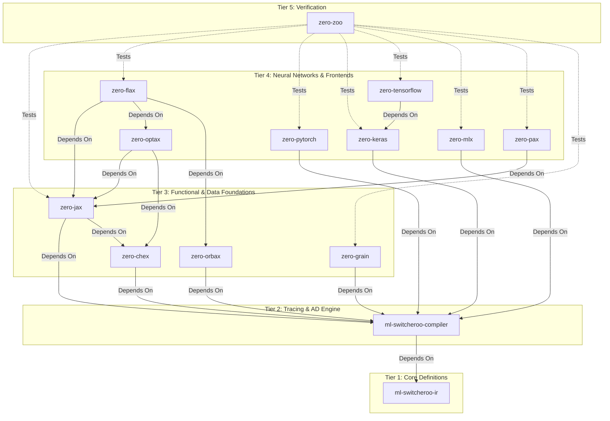
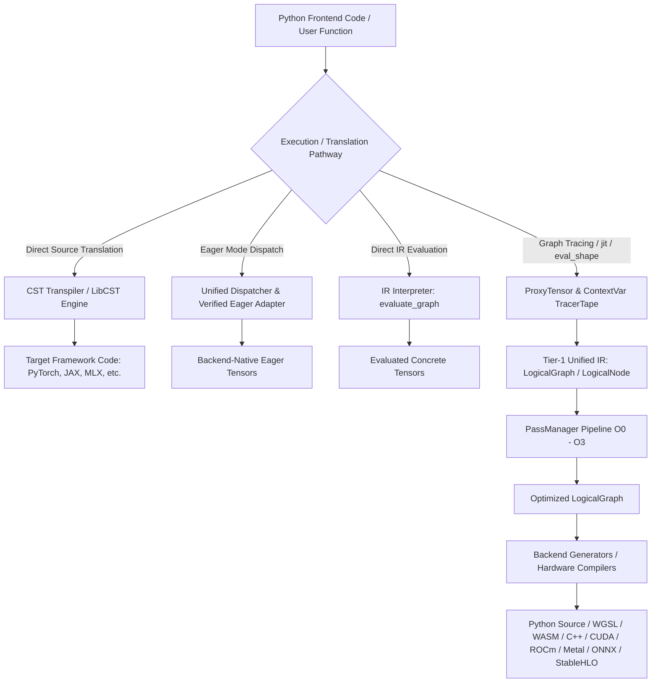
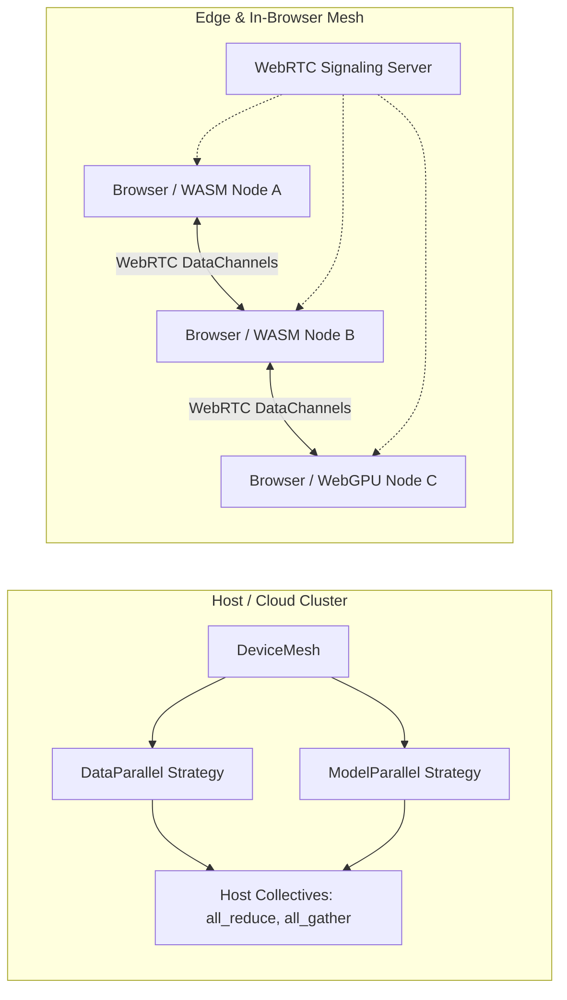
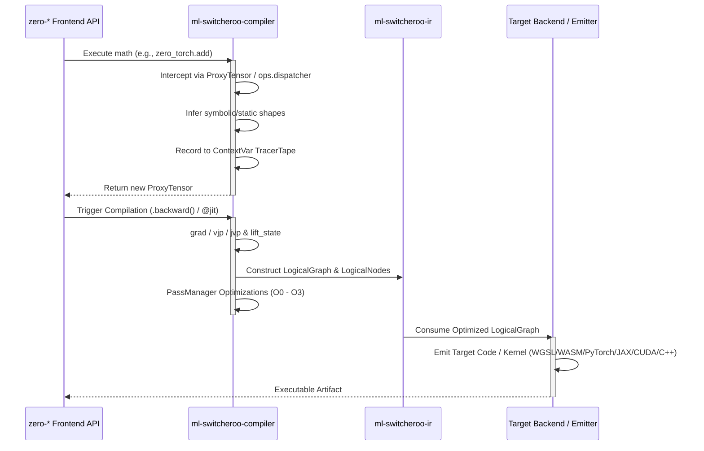

**Current Repository Context:** You are viewing the unified architecture documentation from within the `ml-switcheroo-compiler` repository.

# Abstract ML Machine Ecosystem Architecture

*Note: This architecture document is shared across all repositories in the `zero-*` and `ml-switcheroo-*` ecosystem to provide comprehensive technical context on how the frameworks interoperate.*

## The N-to-M Translation Problem

The Abstract ML Compiler ecosystem is designed to solve the $N \times M$ translation problem in Machine Learning. Instead of writing bespoke translators for every framework (JAX, PyTorch, Keras, TensorFlow, MLX) to every target (WASM, WebGPU, CUDA, ROCm, Metal, LLVM/C++, ONNX, StableHLO), we trace or parse $N$ frontends into a strictly defined Intermediate Representation (IR), which is then consumed by $M$ backends.

This achieves a source-to-source and source-to-browser compilation pipeline utilizing strictly controlled, lightweight core dependencies (`ml-switcheroo-ir`, `libcst`, `pydantic`, `pyyaml`, and `h5py`, with zero runtime framework or global `numpy` lock-in; all array and hardware runtimes are optional and strictly isolated inside their respective backend packages).

## Ecosystem Repository Taxonomy

The ecosystem is strictly hierarchical. Circular dependencies are forbidden. The repositories are organized into tiers:



### 1. `ml-switcheroo-ir` (Tier 1)
The universal, canonical dialect. Defines `LogicalNode`, `LogicalGraph`, `TensorShape`, `TensorSpec`, `PartitionSpec`, `ZeroTangent`, `NoTangent`, and `topological_sort`, alongside ONNX, MLIR, and WGSL schema catalogs without requiring heavyweight external dependencies.

### 2. `ml-switcheroo-compiler` (Tier 2)
The computational heart of the ecosystem. See [Compiler Architecture Deep Dive](#compiler-architecture-deep-dive) below.

### 3. Frontends (`zero-*`) (Tiers 3 & 4)
**Crucial Architecture Note regarding `zero-*` repositories:** The `zero-*` codebases are independent, lightweight frontend API shells. Every `zero-*` repository depends directly or transitively on `ml-switcheroo-compiler` as its core execution and compilation backend.

**The "No Math in Frontends" Rule:** All mathematical implementations, array allocations, gradient tracking logic, and computation graph building inside the `zero-*` repos are forbidden and must delegate to the compiler. The `zero-*` repos purely handle framework-specific API routing, argument parsing (handling kwargs like `dim` vs `axis`), exception mimicry, and syntactic sugar.

* **`zero-jax`**: Mimics the JAX API (`jnp`, `lax`, `jit`, `grad`, `vmap`). Uses PyTree flattening to route state safely into the compiler tape.
* **`zero-pytorch`, `zero-keras`, `zero-tensorflow`, `zero-mlx`**: Mimic eager, object-oriented, and stateful semantics. They dynamically lift mutable states (like `nn.Parameter` or `tf.Variable`) into purely functional graph inputs/outputs via the compiler's internal `lift_state` pass.

### 4. `zero-zoo` (Tier 5)
The proving grounds. Contains identical architectural definitions (MLP, CNN, Micro-Transformer/NanoGPT) written across all frontends. Headless CI pipelines train these deterministically for 10 steps to assert `.allclose()` float-for-float equivalence ("Golden Seed" testing) across all simulated frameworks and final backend compilations.

---

# Compiler Architecture Deep Dive

The `ml-switcheroo-compiler` repository defines the core architecture mapping frontends to backends.

## 1. API Boundaries & Core Structures

### The Universal Tensor Hierarchy
The compiler defines first-class tensor abstractions exported directly from `ml_switcheroo_compiler`:
- **`Tensor`**: Serves as the unified multidimensional backend array. Frontends wrap this class (e.g., `zero_torch.tensor.Tensor` holds `ml_switcheroo_compiler.Tensor` as `.data`, and `zero_jax.numpy.ndarray` wraps it). Implements `shape`, `dtype`, `device`, `requires_grad`, and full Python magic methods, and registers into an identity-keyed weak live-tensor table (`O(1)` eviction on garbage collection without `gc.get_objects()` heap scans).
- **`RaggedTensor`**: Represents non-uniform, nested tensor dimensions with ragged row splits.
- **`SparseTensor`**: Implements sparse tensor representations (coordinate list / COO) for memory-efficient sparse linear algebra.
- **`TensorArray`**: Supports dynamically indexable, growable, and writable sequences of tensors for loop execution and dynamic control flow.

Complementing the root tensor hierarchy, functional data pipeline, PyTree, initialization, and stochastic abstractions live in dedicated compiler modules:
- **`Dataset` (`ml_switcheroo_compiler.core.dataset`)**: Core functional pipeline abstractions for batched tensor transforms and streaming data evaluation.
- **PyTree Utilities (`ml_switcheroo_compiler.tree_util`)**: Structural tree flattening, unflattening, and leaf mapping (`TreeDef`, `tree_flatten`, `tree_unflatten`, `tree_map`) backing `jit`, AD, and functional state lifting.
- **Stateless Initializers (`ml_switcheroo_compiler.nn`)**: Pure mathematical parameter initializers (`initializers.py`, e.g., `glorot_uniform`, `kaiming_normal`, `orthogonal`, `variance_scaling`) free of OOP layer state.
- **Stochastic Distributions & PRNG (`ml_switcheroo_compiler.random`)**: Continuous and discrete probability distributions (`continuous/`, `distributions_discrete.py`), explicit PRNG state (`rng_uniform`), and `shuffle`.

### Configuration & Context-Isolated State Management
The `ml_switcheroo_compiler.core.config.config` singleton controls execution flow (`eager_mode`, `backend`, `default_float_dtype`, `default_int_dtype`, `default_device`, `current_stream`, `seed`). Its backing `ConfigState` is stored in a `contextvars.ContextVar` with lazy per-thread initialization and copy-on-write property updates, ensuring spawned `threading.Thread` workers and concurrent `asyncio` tasks remain isolated. Environment variables (`SWITCHEROO_EAGER_MODE=1`, `SWITCHEROO_BACKEND=numpy`) configure defaults at startup.

### Error Handling Hierarchy
Rooted at `CompilerError` (`SwitcherooError`) in `ml_switcheroo_compiler.core.errors`, specific exception classes—including `TracingError`, `CompilationError`, `EvaluationError`, `ShapeInferenceError`, `ShapeMismatchError`, `DTypePromotionError`, `DTypeValidationError`, `BackendNotSupportedError`, `UnimplementedMathError`, `AutodiffError`, `AutodiffLinkageError`, `SymbolicDifferentiationError`, `MissingJVPRuleError`, `FrontendBoundaryViolationError`, `BackendDecouplingError`, `DependencyViolationError`, and `SnapshotGroundingError`—provide structured diagnostics carrying node ID, op type, backend target, and trace context.

## 2. Core Execution Engine Modes & Pathways

The compiler supports four primary execution and translation pathways:



### Unified Operation Dispatch & Eager Mode
- **Unified Dispatcher (`ml_switcheroo_compiler.ops.dispatcher`)**: Centralizes execution-mode resolution (`is_eager_execution_active`) and single/multi-output routing (`dispatch_op`, `dispatch_multi_op`, `dispatch_backend_eager_op`, `dispatch_submodule_op`) across eager execution and active graph tracing.
- **Pluggable Eager Adapters & Reference Ops**: Eager operations execute through the active backend's verified `EagerBackendAdapter` / `CoreEagerDictionary` (`numpy`, `pure_python`, `pytorch`, `jax`, `tensorflow`, `keras`, `mlx`, `dask`, or domain-eager backends), supplemented by pure-Python backend-agnostic reference kernels in `ml_switcheroo_compiler.backends.eager` (with zero global `numpy` or `scipy` imports outside `backends/numpy`).
- **Graph Interpreter (`evaluate_graph`)**: Located in `ml_switcheroo_compiler.interpreter.evaluator`, traverses a `LogicalGraph` in topological order to evaluate operations on concrete inputs without intermediate source code generation.

### Graph Tracing Engine & `jit` / `eval_shape`
Constructs the Intermediate Representation by intercepting operations on proxy variables (`ml_switcheroo_compiler.tracing.ProxyTensor`).
- **`ContextVar`-Isolated `TracerTape` & `TracingState`**: Managed via `global_tracing_state` (`ml_switcheroo_compiler.tracing.state`), isolating `is_tracing`, `active_graph`, `graph_stack`, `constant_cache`, and `LoopOptions` across OS threads and `asyncio` tasks.
- **`jit`, `disable_jit`, & Symbolic `eval_shape` (`ml_switcheroo_compiler.grad.jit`)**:
  - `jit` traces PyTree inputs once per `(fun_id, static_args, treedef, input_specs, backend, device, keep_unused)` cache key, runs `PassManager` optimizations (constant folding, CSE, DCE, and dead-input pruning), composes inline with nested `grad(jit(f))` / `jit(grad(f))`, and respects `ContextVar`-scoped `disable_jit()`.
  - `eval_shape` performs zero-allocation symbolic shape/dtype propagation over `Tensor`, `TensorSpec`, or `TensorConfig` PyTrees using `ProxyTensor` without allocating concrete buffers.
- **Foreign Graph Ingestion**: External framework graphs ingest directly into `LogicalGraph` via `ingest_torch_fx` (`backends/pytorch/fx_ingest.py`), `ingest_jaxpr` (`backends/jax/jaxpr_ingest.py`), and `ForeignCall` IR nodes.

### Automatic Differentiation (AD)
Located in `ml_switcheroo_compiler.grad` and `ml_switcheroo_compiler.transforms.autodiff`:
- Reverse-mode (`grad`, `value_and_grad`, `backward`, `vjp`, `ir_grad`) and forward-mode (`jvp`, `jacfwd`) AD engines, plus higher-order derivatives (`jacrev`, `hessian`, `hvp`, `nth_order_grad`).
- Custom derivative hooks (`custom_jvp`, `custom_vjp`, `RegisterGradient`) backed by a bounded LRU and `ContextVar`-scoped callback registry (`ml_switcheroo_compiler.ir.callback_registry`).
- Memory-budgeted checkpointing (`checkpoint`, `remat`, `recompute_grad` in `grad/checkpointing.py`) implementing dynamic programming (Knapsack) and binomial rematerialization schedules.

### Higher-Order Control Flow
Implements universal cross-framework primitives (`cond`, `while_loop`, `scan`, `vmap`, `pmap`, `map_fn` under `ml_switcheroo_compiler.ops.control_flow`), lowering Python control flow into structured IR subgraphs without runtime loop-unrolling bloat.

### Concrete Syntax Tree (CST) Source-to-Source Transpiler
Located in `ml_switcheroo_compiler.backends.cst_transpiler`:
- Uses `libcst` (`transpile_source`, `ASTPatternMatcher`, `CSTTransformer`, `StateLiftingTransformer`) to perform whitespace- and comment-preserving static transpilation across frameworks without runtime graph tracing:
  - Framework import and symbol mapping (e.g., `torch.nn` $\leftrightarrow$ `jax.nn` $\leftrightarrow$ `mlx.nn`).
  - Rewriting positional/keyword differences (e.g., `dim` vs. `axis`, `keepdim` vs. `keepdims`).
  - Lifting stateful OOP classes into pure functional parameter PyTrees.

## 3. Unified Intermediate Representation (IR) Schema

### Tier-1 `ml-switcheroo-ir` Core Structures
All shared graph and node models are imported directly from `ml_switcheroo_ir` (never vendored or monkey-patched at runtime, preserving `model_config["extra"] == "forbid"`):
- **`LogicalGraph` (`IRGraph`)**: Encapsulates module `inputs`, `outputs`, `input_specs`, and `nodes: NodeDict` (`key == node.id` invariant).
- **`LogicalNode` (`IRNode`)**: Tracks individual operations with fields:
  - `id`: Unique node identifier.
  - `op_type`: Canonical operator string (e.g., `"Add"`, `"Conv"`, `"MatMul"`, `"ForeignCall"`).
  - `domain`: Operator domain namespace (e.g., `""`, `"ai.onnx"`).
  - `inputs` / `outputs`: Ordered input and versioned output node IDs.
  - `attributes`: Validated `dict[str, AttributeValue]`.
  - `shape_metadata` / `shape`: Raw dimension tuple (`shape_metadata`) and `TensorShape` wrapper (`shape`).
  - `dtype` / `output_specs`: Canonical `ml_switcheroo_ir.DType` and `list[TensorSpec]`.
  - `source_ast_ref`: Source file path, line number, and AST identifier for traceback localization (`backends/linker.py`).
  - `sharding`, `device`, `stream`: SPMD `PartitionSpec`, device placement, and execution stream metadata.
  - `subgraphs`: Scoped control-flow blocks (`dict[str, LogicalGraph]`, e.g., `"body"`, `"cond"`, `"then_branch"`, `"else_branch"`).
- **`ZeroTangent` / `NoTangent`**: Explicit IR representations for zero-gradient and non-differentiable execution paths.

### Compiler-Local IR Utilities (`ml_switcheroo_compiler.ir`)
- **Symbolic Shape Algebra (`ir/shape_system.py`)**: `SymNode`, `SymInt`, `SymVar`, `SymConst`, `Polynomial`, `ShapeTracker`, and `SymbolicConstraintTracker` implement `ml_switcheroo_ir` symbolic protocols (`SymbolicNodeProtocol`, `SymbolicIntWrapperProtocol`) to solve dynamic dimensions mathematically prior to execution.
- **Narrowing & Cloning (`ir/core.py`)**: Type-safe helpers (`ensure_graph`, `ensure_attrs`, `ensure_attr_val`, `clone_logical_node`) bridging compiler dtypes/devices with `ml_switcheroo_ir` protocols.
- **State Mutation Functionalization (`ir/state.py`)**: `create_read_variable`, `create_assign_variable`, and `create_scatter_update` bridge OOP parameter mutations into pure functional dataflow.

## 4. Middle-End Transformations (Pass Manager)

Before lowering to source code or executable backends, `PassManager` (`ml_switcheroo_compiler.transforms.pass_manager`) validates DAG invariants (`IRValidator`) and executes the staged `O0`–`O3` optimization schedules defined in `transforms/passes/pass_pipeline.yaml`, complemented by standalone canonicalization, quantization, and target-lowering passes in `transforms/passes/`.

```mermaid
flowchart TD
    InputIR[Raw Unified IR] --> Canonical[Stage 1: Frontend Canonicalization]
    Canonical --> Algebraic[Stage 2: Algebraic Simplifications]
    Algebraic --> LowLevel[Stage 3: Fusion, Scheduling & Distribution]
    LowLevel --> OutputIR[Optimized IR to Emitter]

    subgraph Stage 1: Canonicalization & Inference Passes
        PL[polyfill_lowering_pass]
        SI[shape_inference_pass / dtype_inference_pass]
        TP[type_promotion_explicitizer_pass]
        BE[broadcast_explicitizer_pass]
        SL[lift_state_pass / StateLoweringPass]
        AT[axis_translation_pass]
        PL --> SI --> TP --> BE --> SL --> AT
    end

    subgraph Stage 2: Algebraic & Control-Flow Simplifications
        CF[constant_folding_pass]
        DCE[dead_code_elimination_pass]
        CSE[common_subexpression_elimination_pass]
        CFO[control_flow_optimization_pass]
        BNF[batch_norm_folding_pass]
        PS[parallel_scan_pass]
        CF --> DCE --> CSE --> CFO --> BNF --> PS
    end

    subgraph Stage 3: Low-Level, Distributed & Edge Passes
        OF[operator_fusion_pass]
        GS[GraphSchedulingPass]
        BA[BufferAllocationPass]
        SPMD[spmd_partitioning_pass]
        MP[mixed_precision_pass / PTQPass & QATFakeQuantizePass]
        LT[loop_tiling_pass / loop_unrolling_pass]
        VEC[vectorization_pass]
        OF --> GS --> BA --> SPMD --> MP --> LT --> VEC
    end
```

### Canonicalization & Inference Passes (`transforms/passes/`)
- **`polyfill_lowering_pass`** *(pipeline `O0`–`O3`)*: Rewrites composite operations into canonical elementary primitives.
- **`type_promotion_explicitizer_pass` & `broadcast_explicitizer_pass`** *(pipeline `O0`–`O3`)*: Eliminates implicit casting and broadcasting by inserting explicit `Cast` and `BroadcastTo` nodes.
- **`shape_inference_pass` & `dtype_inference_pass`** *(standalone)*: Propagates static/symbolic dimensions and element types across nodes.
- **`lift_state_pass` / `StateLoweringPass` (`state_lowering_pass`)** *(standalone)*: Converts mutable state assignments into explicit functional graph inputs and outputs (and vice-versa).
- **`axis_translation_pass`** *(standalone)*: Injects `Transpose` nodes to reconcile differing tensor layouts (e.g., NCHW vs. NHWC).

### Target-Agnostic Optimizations
- **`constant_folding_pass`** *(pipeline `O1`–`O3`)*: Pre-computes static subgraphs while guarding stateful and opaque custom-AD callback nodes.
- **`dead_code_elimination_pass` (DCE)** *(pipeline `O1`–`O3`)*: Prunes unreferenced nodes from the IR graph.
- **`common_subexpression_elimination_pass` (CSE)** *(pipeline `O2`–`O3`)*: Merges structurally identical operations via canonical hashing.
- **`control_flow_optimization_pass`** *(standalone)*: Simplifies constant branches and loop invariants.
- **`batch_norm_folding_pass`** *(standalone)*: Fuses batch normalization parameters into adjacent convolutional weights.
- **`parallel_scan_pass`** *(standalone)*: Rewrites associative prefix scans into logarithmic-depth parallel patterns.
- **`strip_offline_diagnostic_nodes_pass`** *(standalone)*: Strips offline diagnostic/inspection ops prior to deployment emission.

### Low-Level, Hardware & Distributed Passes
- **`operator_fusion_pass` (`HorizontalFusionPass`, `VerticalFusionPass`)** *(pipeline `O2`–`O3`)*: Fuses consecutive elementwise and reduction clusters using cost models.
- **`GraphSchedulingPass` (`graph_scheduling_pass`)** *(pipeline `O2`–`O3`)*: Computes memory-aware topological execution schedules.
- **`BufferAllocationPass` (`buffer_allocation_pass`)** *(pipeline `O2`–`O3`)*: Plans reuse-aware contiguous linear memory offsets for WebGPU and WASM runtimes.
- **`spmd_partitioning_pass` & `inject_spmd_communication_pass`** *(pipeline `O3` / standalone)*: Partitions sharded graphs and injects collective operations (`all_reduce`, `all_gather`, `reduce_scatter`).
- **`mixed_precision_pass`** *(pipeline `O3`)*, **`PTQPass` / `QATFakeQuantizePass` / `IntegerQuantizationLoweringPass`** (`quantization.py`), **& `rematerialization_pass`** *(standalone)*: Handles FP16/BF16 casting, calibrated PTQ/QAT INT8/INT4 lowering (`QuantizationConfig`), and activation checkpointing.
- **`loop_tiling_pass` & `vectorization_pass`** *(pipeline `O3`)*, **& `loop_unrolling_pass`** *(standalone)*: Hardware-level transformations generating cache- and SIMD-friendly compute strides.

## 5. Distributed Runtime & WebRTC Mesh

Located in `ml_switcheroo_compiler.distributed`:



- **Topologies & Sharding**: `DeviceMesh` organizes multi-dimensional hardware topologies; `DataParallel`, `ModelParallel`, `LayoutMap`, and `PartitionSpec` annotate tensors for SPMD partitioning.
- **Distributed Collectives**: `all_reduce`, `all_gather`, `reduce_scatter`, `broadcast`, and `shard_tensor` execute across host communicators or backend-native collectives.
- **WebRTC Edge Mesh**: Includes a WebRTC signaling protocol (`webrtc_signaling.py`) and browser collective layer (`backends/edge/distributed_webrtc/`), enabling peer-to-peer WebAssembly/WebGPU training without central parameter-server bottlenecks.

## 6. Emission Backends, Capability Typeclasses & Target Compilers

Backends register dynamically via `@register_backend("name")` in `ml_switcheroo_compiler.backends.registry.BackendRegistry`.

### Haskell-Style Backend Capability Typeclasses
Defined in `ml_switcheroo_compiler.backends.typeclasses` and enforced statically by `ml_switcheroo_compiler.backends.typeclass_verifier` (`scripts/verify_typeclasses.py`):
- **`CapabilityKind`**: Declares closed backend traits (`CODE_EMIT`, `CORE_EAGER`, `DOMAIN_EAGER`, `AOT_COMPILE`, `HARDWARE_KERNEL`, `SERIALIZED_ARTIFACT`).
- **`CoreEagerTypeclass[TensorT]` & `CoreEagerDictionary[TensorT]`**: Parameterized dictionary-passing protocols (`CreationTypeclass`, `ElementwiseUnaryTypeclass`, `ElementwiseBinaryTypeclass`, `LinearAlgebraTypeclass`, `ReductionTypeclass`) verified under `mypy --strict` and required across all 8 dense `CORE_EAGER` backends (`numpy`, `pure_python`, `pytorch`, `jax`, `tensorflow`, `keras`, `mlx`, `dask`), while specialized runtimes (`cupy`, `numba`, `sparse`, `dpnp`, `awkward`, `pyarrow_compute`) declare `DOMAIN_EAGER`.
- **`CodeEmitterTypeclass` & `AOTCompilerTypeclass`**: Structural protocols verified alongside curated backend YAML `mappings/*.yaml` schemas.

### Python & Array Backends
- **PyTorch (`pytorch` / `torch`)**: Emits `torch.nn.Module` classes and functional scripts; supports `CORE_EAGER` execution and `ingest_torch_fx`.
- **JAX (`jax`)**: Emits functional JAX PyTree topologies (`jax.numpy`); supports `CORE_EAGER` execution and `ingest_jaxpr`.
- **MLX (`mlx`)**: Emits Apple Silicon MLX modules (`CORE_EAGER`).
- **Keras (`keras`) & TensorFlow (`tensorflow`)**: Emits Keras 3 and TensorFlow graph topologies (`CORE_EAGER`).
- **NumPy (`numpy`)**: Isolated NumPy/SciPy vectorized execution and code generation backend (`CORE_EAGER`).
- **Pure Python (`pure_python`)**: Zero-dependency reference code generator and `CORE_EAGER` execution backend.
- **CuPy (`cupy`)**: Emits CUDA-accelerated CuPy scripts (`DOMAIN_EAGER`).
- **Dask (`dask`)**: Emits lazy distributed Dask Array task graphs (`CORE_EAGER`).
- **Numba (`numba`)**: Emits JIT-compiled `@njit` kernels (`DOMAIN_EAGER`).
- **Sparse (`sparse` / `sparse_coo`)**: Emits coordinate (COO) sparse tensor code (`DOMAIN_EAGER`).
- **Data Parallel NumPy (`dpnp`)**: Emits SYCL-accelerated Intel CPU/GPU array code (`DOMAIN_EAGER`).
- **Awkward Array (`awkward`)**: Emits jagged/nested array operations (`DOMAIN_EAGER`).
- **PyArrow Compute (`pyarrow_compute`)**: Emits Apache Arrow columnar compute pipelines (`DOMAIN_EAGER`).

### Hardware Backends & Kernel Code Generation
- **CPU (LLVM / C++) (`llvm_cpp`)**: Generates vectorized C++17 implementations with MLIR registry grounding.
- **CUDA / PTX (`cuda`)**: Generates native NVIDIA CUDA `.cu` source kernels.
- **ROCm (`rocm`)**: Emits AMD HIP GPU kernels.
- **Metal Shading Language (`metal`)**: Generates Apple Silicon MSL compute shaders.

### Edge & Web Native Backends
- **WebGPU (`webgpu` / `edge_wgsl`)**: Translates IR graphs into WGSL compute shaders, buffer bindings, and JS orchestrator harnesses.
- **WebGL 2.0 (`edge_webgl`)**: Fallback browser compute backend mapping tensors to 2D fragment shaders.
- **WASM SIMD (`edge_wasm` / `edge_wasm_simd`)**: Emits C++ kernels using 128-bit SIMD intrinsics (`wasm_f32x4_*`) compilable to standalone WebAssembly modules.
- **ONNX (`edge` / `edge_onnx`)**: Serializes `LogicalGraph` directly into ONNX wire format without requiring the external `onnx` package at emission time.
- **StableHLO (`edge_stablehlo`)**: Emits MLIR-compliant StableHLO textual and bytecode (`mlir_bytecode.py`) representations for OpenXLA toolchains.

## 7. Diagnostics, Benchmarking, Serialization & Export

### Diagnostics & Anomaly Detection (`ml_switcheroo_compiler.diagnostics`)
- **`flop_counter`**: Computes theoretical FLOP and MAC counts across `LogicalGraph` nodes.
- **`memory_profiler`**: Estimates peak working-set memory and buffer lifetimes.
- **`numerical_anomaly` & `debugging`**: Detects NaNs, infinities, and vanishing/exploding gradients, and configures debug dump hooks (`enable_dump_debug_info`).
- **`shape_debugger` & `summary`**: Tracks symbolic dimension compatibility and prints structured model summaries.

### Cross-Backend Benchmarking (`ml_switcheroo_compiler.benchmarks`)
- **`BenchmarkOrchestrator` (`orchestrator.py`) & `metrics.py`**: Executes declarative workload plans (`BenchmarkSuite`, `BenchmarkPlan`, `ModelWorkload`) across isolated backends, evaluating latency thresholds, device constraints, and numerical precision targets (`BenchmarkRunResult`).

### Serialization & Ahead-Of-Time (AOT) Export (`serialization/` & `export/`)
- **Weight & Model Formats (`ml_switcheroo_compiler.serialization`)**: First-class loaders/savers for SafeTensors (`SafetensorsWeightFormat`), HDF5 (`h5py`), NumPy `.npz`, Pickle, IR JSON/YAML archives, and SavedModel bundles.
- **AOT & SavedModel Export (`ml_switcheroo_compiler.export`)**: Packages pre-compiled deployment artifacts (`aot.py`) and TensorFlow SavedModel Protobuf exports (`export_api.py`, `pb_utils.py`).

---

## Compilation Pipeline & Data Flow

When a user executes code in any `zero-*` frontend, the frontend delegates math, tracing, `jit`, and AD to `ml-switcheroo-compiler`, lowering high-level calls into optimized target source code or native edge binaries.



---

## 8. Architectural Boundaries & Decoupling Guarantees

The codebase enforces six non-negotiable architectural and static-verification invariants via automated pre-commit linters and CI boundary tests:
1. **Frontend Independence (The "No API Shell" Rule):** `ml-switcheroo-compiler` contains zero Tier 3/4 frontend API shells; core layers expose universal, backend-agnostic operations (`ml_switcheroo_compiler.ops`).
2. **N-to-M Universal Utility (`scripts/validate_rules.py`):** Every compiler operation and pass reduces to `ml-switcheroo-ir` and targets multiple backends, with opaque external operations represented via `ForeignCall`.
3. **Single-Backend Dependency Isolation (`scripts/lint_dependencies.py`):** Each `backends/<target>/` package imports at most one external framework root, and upward imports from `zero-*` or `zero-zoo` are strictly forbidden.
4. **Zero Global NumPy Leaks (`scripts/lint_numpy_leak.py` & `scripts/lint_dynamic_numpy.py`):** `numpy` and `scipy` are isolated exclusively inside `backends/numpy/`; cross-backend fallbacks are prohibited.
5. **Static Typeclass & Snapshot Grounding Verification (`scripts/verify_typeclasses.py`, `scripts/validate_backend_mappings.py`, `scripts/validate_parameters.py`, & `scripts/check_snapshot_drift.py`):** Every `@register_backend` class and curated YAML mapping file is verified statically for protocol conformance (`CodeEmitterTypeclass`, `AOTCompilerTypeclass`, `CoreEagerTypeclass`), zero hallucinated parameters, and upstream `ml-ecosystem-snapshots` parity.
6. **Strict Typing, Anti-Reflection & Coverage Gates (`mypy --strict`, `scripts/lint_any.py`, `scripts/lint_typing.py`, `scripts/lint_pass.py`, & `scripts/check_docs.py`):** Enforces zero `typing.Any`, forbids dynamic attribute reflection (`getattr`/`setattr`/`hasattr`), `typing.cast`, disguised casts, and tautological or zero-assertion tests, and verifies 100% line/branch coverage alongside granular AST parameter/return docstring parity.
