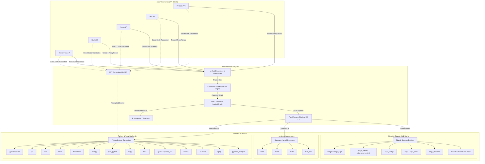
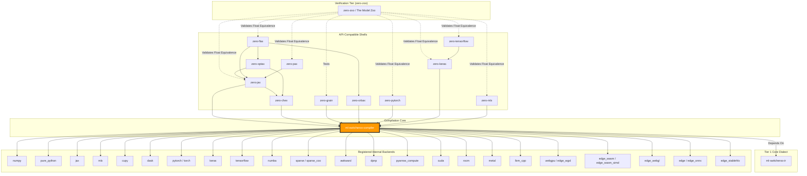

# zero-* Engine Core

> **Note:** This repository serves as the core execution engine and abstract representation framework for the `zero-*` ecosystem.

# [ml-switcheroo-compiler](https://github.com/SamuelMarks/ml-switcheroo-compiler)

[](https://opensource.org/licenses/Apache-2.0)
[](https://github.com/SamuelMarks/ml-switcheroo-compiler/actions)
[](https://github.com/SamuelMarks/ml-switcheroo-compiler/actions/workflows/release.yml)
[](#)
[](#)

The `ml-switcheroo-compiler` is the universal hub and core execution engine for the ML Switcheroo ecosystem. Built directly on Tier-1 [`ml-switcheroo-ir`](https://github.com/SamuelMarks/ml-switcheroo-ir) with zero runtime framework or global `numpy` lock-in, it provides a direct Concrete Syntax Tree (CST) transpiler, composable `jit` and Automatic Differentiation (AD), Haskell-style verified backend capability typeclasses, and a multi-stage optimization pipeline to translate machine learning models across Python frameworks and compile them directly for hardware, edge, and browser execution.

Crucially, this architecture empowers developers to run forward and backward passes directly in the browser for exact shape learning, coordinate peer-to-peer distributed browser training meshes over WebRTC, and empirically benchmark any ML syntax across isolated execution backends.

## Core Data Structures

Exported directly from the root namespace (`ml_switcheroo_compiler`), the compiler defines a unified tensor hierarchy:
- **`Tensor`**: The universal dense multidimensional array backing all frontend interfaces (e.g., `zero-pytorch`, `zero-jax`), tracked via an `O(1)` identity-keyed weak registry.
- **`RaggedTensor`**: First-class representation for non-uniform, nested tensor dimensions with ragged splits.
- **`SparseTensor`**: Memory-efficient coordinate list (COO) representation for sparse linear algebra.
- **`TensorArray`**: Dynamically indexable, growable, and writable sequences of tensors for dynamic control flow loops.

Complementing the tensor hierarchy, functional dataset pipeline abstractions are provided under `ml_switcheroo_compiler.core.dataset`:
- **`Dataset`**: Functional data transformation pipelines and batched streaming iterators.

## Major Project Goals

1. **In-Browser Shape Learning & Transpilation:** Enhance the original [ML Switcheroo](https://samuelmarks.github.io/ml-switcheroo) project (focused on ML framework and SASS/RDNA transpilation) with the ability to learn precise tensor shapes by executing actual forward and backward passes directly in the browser.
2. **Cross-Backend Benchmarking:** Benchmark different execution backends independently of the frontend API (e.g., testing TensorFlow syntax running on the MLX backend) with strict single-backend dependency isolation and zero cross-backend NumPy fallbacks.
3. **Decentralized Edge & Browser Mesh:** Enable distributed, serverless peer-to-peer collective execution (`AllReduce`, `AllGather`) directly across WebAssembly and WebGPU clients using built-in WebRTC signaling and data channels.

## Architectural Vision

The compiler resolves the impedance mismatch between machine learning paradigms, operating as a strictly decoupled, purely functional computational hub (Tier 2) with three primary targets:

1. **Source-to-Source (AST / CST) Transpilation:** Convert ML source code between frameworks like PyTorch, Keras, TensorFlow, JAX, and MLX using `libcst` for direct syntax transformation (rewriting arguments, mapping modules, and lifting stateful OOP classes into pure PyTree parameter dictionaries) as well as the Unified IR (`ml-switcheroo-ir`) for semantic re-emission.
2. **Hardware Acceleration & Kernel Generation:** Lower computation graphs into native GPU and accelerator kernels targeting NVIDIA CUDA (`.cu`), AMD ROCm/HIP, Apple Silicon Metal Shading Language (MSL), Numba JIT, and LLVM/C++ vectorized CPU routines.
3. **Direct-to-Edge & Browser Compilation:** Bypass Python runtimes by lowering Unified IR graphs down to browser and edge executables powered by **WebGPU** (`webgpu` / `edge_wgsl`), **WebGL 2.0** (`edge_webgl`), and **WASM SIMD** (`edge_wasm` / `edge_wasm_simd`), or export to standardized exchange formats (**ONNX** via `edge_onnx`, **StableHLO** & MLIR bytecode via `edge_stablehlo`).

**Strict Decoupling Rule ("No Math in Frontends"):** The `ml-switcheroo-compiler` repository is exclusively responsible for all math, `jit` compilation, Automatic Differentiation (AD), and graph transformations. Frontend repositories (`zero-pytorch`, `zero-jax`, etc.) contain NO math implementations; they are purely Tier 3/4 lightweight API shells that route inputs and lift object-oriented state into this compiler. Likewise, this compiler strictly forbids any framework-specific API shells or global `numpy` leaks.

Please refer to [`ARCHITECTURE.md`](ARCHITECTURE.md) for an in-depth dive into the compiler's architecture, intermediate representation, execution engine modes, typeclass verification, and transformation pipeline.

## Compilation Pipeline



- **Tier-1 Unified IR (`ml-switcheroo-ir`):** A strict, framework-agnostic intermediate representation (`LogicalGraph` / `LogicalNode`) paired with compiler symbolic shape algebra (`SymInt`, `ShapeTracker`), mathematical primitives, control flow, and functional state management.
- **Middle-End Optimization:** Executes multi-stage optimization passes configured from `O0` to `O3` (canonicalization, shape/dtype inference, constant folding, CSE, DCE, control-flow simplification, operator fusion, buffer allocation, loop tiling/unrolling, vectorization, batch norm folding, mixed precision, quantization, and SPMD partitioning) before code generation.
- **Python Emission & CST Transpilation:** Emits idiomatic source code for target frameworks or directly rewrites syntax trees across framework dialects.
- **Hardware & Edge Emission:** Translates computation graphs into CUDA `.cu`, ROCm HIP, Metal MSL, C++17, WGSL compute shaders, WASM SIMD kernels, ONNX models, and StableHLO/MLIR artifacts.

## Advanced Transformations and Distributed Support

The engine supports a comprehensive suite of advanced optimizations and parity features across backends:
- **`jit` Compilation, `disable_jit`, & Symbolic `eval_shape`:** PyTree-aware `jit` compilation with `(static_args, input_specs, backend, device, keep_unused)` caching, `ContextVar`-scoped `disable_jit()`, inline `grad(jit(f))` / `jit(grad(f))` composition, and zero-allocation symbolic shape inference via `eval_shape` (`ml_switcheroo_compiler.grad`).
- **Haskell-Style Backend Capability Typeclasses:** Parameterized capability protocols (`CoreEagerTypeclass`, `CapabilityKind.CORE_EAGER` vs `DOMAIN_EAGER`, `CodeEmitterTypeclass`, `AOTCompilerTypeclass`) statically verified across registered backends and curated YAML mappings via `ml_switcheroo_compiler.backends.typeclasses` and `scripts/verify_typeclasses.py`.
- **Compiler Optimizations:** Built-in Dead Code Elimination (DCE), Common Subexpression Elimination (CSE), Constant Folding, Operator Fusion, Loop Tiling & Unrolling, Buffer Allocation & Graph Scheduling, Vectorization, Batch Normalization folding, Mixed Precision casting, and Quantization passes (PTQ, QAT, and INT8/INT4 lowering) via `PassManager`.
- **Foreign Graph Ingestion:** Ingest external framework computation graphs directly into `LogicalGraph` via `ingest_torch_fx` (PyTorch `torch.fx.GraphModule`), `ingest_jaxpr` (JAX `jaxpr`), and `ForeignCall` nodes without manual rewrites.
- **Model Serialization & Formats:** First-class model export and weight serialization supporting SafeTensors (`SafetensorsWeightFormat`), HDF5 (`h5py`), NumPy (`npz`), Python Pickle, and TensorFlow SavedModel Protobuf (`export_api`).
- **Diagnostics & Profiling Suite:** Integrated FLOP counter (`flop_counter`), peak memory profiler (`memory_profiler`), automated NaN/Inf numerical anomaly detection (`numerical_anomaly`), live shape debugging (`shape_debugger`), and architectural layer inspection (`summary`).
- **Automatic Differentiation:** Full support for `jvp` (Forward-Mode), `vjp` / `grad` / `backward` (Reverse-Mode), and higher-order derivatives (`hessian`, `hvp`, `jacfwd`, `jacrev`, `nth_order_grad`), accompanied by dynamic programming (Knapsack) memory-budgeted checkpointing, binomial rematerialization schedules, and scoped `custom_jvp` / `custom_vjp` hooks.
- **Distributed Topologies, Collectives & Edge Mesh:** Device meshes (`DeviceMesh`), layout maps (`LayoutMap`), `PartitionSpec` sharding, host collectives (`all_reduce`, `all_gather`, `reduce_scatter`, `broadcast`, `shard_tensor`), and browser-to-browser P2P WebRTC data channels.

## Core Execution Modes

The engine supports four distinct execution and translation paradigms:

- **Eager Mode (Unified Backend Dispatch):** Immediate-execution path routed via `ml_switcheroo_compiler.ops.dispatcher` to the active backend's verified eager typeclass dictionary (e.g., `numpy`, `pure_python`, `pytorch`, `jax`, `tensorflow`, `keras`, `mlx`, `dask`, or domain-eager backends) alongside pure-Python reference helpers in `ml_switcheroo_compiler.backends.eager` (with zero global NumPy dependency).
- **Graph Interpreter Mode (Direct IR Evaluation):** Direct topological execution of `LogicalGraph` structures on concrete input tensors using `ml_switcheroo_compiler.interpreter.evaluate_graph` without intermediate code generation.
- **Graph Mode (Traced & `jit`-Compiled):** Tracing execution path using `ProxyTensor` and `ContextVar`-isolated `TracerTape` / `TracingState` (`ml_switcheroo_compiler.tracing`) plus `jit` / `eval_shape` (`ml_switcheroo_compiler.grad.jit`), optimizing the resulting `LogicalGraph` via `PassManager` before lowering to target emitters.
- **CST Transpilation Mode (Direct Source-to-Source):** Static, whitespace-preserving syntax rewriting via `ml_switcheroo_compiler.backends.cst_transpiler.transpile_source` across framework dialects.

## Ecosystem Dependency Graph



## Internal Backends

Execution and code emission are delegated to isolated backends registered dynamically via `BackendRegistry` (`@register_backend`):

### Dense `CORE_EAGER` & Source Backends
- **`numpy`**: Isolated NumPy & SciPy vectorized CPU execution and code generation backend.
- **`pure_python`**: Zero-dependency reference pure-Python execution and code generation backend.
- **`pytorch` (`torch`)**: PyTorch eager execution, `torch.fx` ingestion, and `torch.nn.Module` generation backend.
- **`jax`**: Functional JAX array execution, `jaxpr` ingestion, and code generation backend.
- **`mlx`**: Apple Silicon MLX execution and functional module generation backend.
- **`keras`**: Modern Keras 3 execution and model generation backend.
- **`tensorflow`**: TensorFlow execution and graph generation backend.
- **`dask`**: Lazy distributed Dask Array task graph backend.

### Domain-Specialized `DOMAIN_EAGER` Backends
- **`cupy`**: GPU-accelerated array computing backend for NVIDIA hardware.
- **`numba`**: JIT-compiled `@njit` kernel execution and generation backend.
- **`sparse` (`sparse_coo`)**: Coordinate-format (COO) multidimensional sparse tensor backend.
- **`awkward`**: Awkward Array backend for ragged, nested, and variable-sized structures.
- **`dpnp`**: Intel oneAPI Data Parallel NumPy (SYCL) CPU/GPU acceleration backend.
- **`pyarrow_compute`**: Apache Arrow Compute backend for columnar tensor operations.

### Hardware & Edge Native Backends
- **`llvm_cpp`**: Vectorized C++17 and LLVM CPU kernel code generation backend.
- **`cuda`**: Native NVIDIA CUDA (`.cu`) kernel code generation backend.
- **`rocm`**: Native AMD ROCm/HIP GPU kernel code generation backend.
- **`metal`**: Apple Silicon Metal Shading Language (MSL) compute shader backend.
- **`webgpu` (`edge_wgsl`)**: In-browser GPU compute shader (WGSL) and JS harness emitter.
- **`edge_wasm` (`edge_wasm_simd`)**: Standalone C++/WASM SIMD (`v128`) kernel emitter.
- **`edge_webgl`**: Fallback in-browser WebGL 2.0 fragment-shader compute emitter.
- **`edge` (`edge_onnx`)**: Dependency-free ONNX wire-format model serializer.
- **`edge_stablehlo`**: OpenXLA StableHLO text and MLIR bytecode emitter.

---

## Command-Line Interface (CLI)

The package installs the `ml-switcheroo-compiler` (and `ml_switcheroo_compiler`) CLI entrypoint:

```bash
# List all registered backend identifiers
ml-switcheroo-compiler backends

# Transpile or compile a Python model file to a target framework or edge backend
ml-switcheroo-compiler compile model.py --target jax -o model_jax.py
ml-switcheroo-compiler compile model.py --target webgpu -o model.wgsl.js
```

---

## Development & Testing

This project enforces strict environment isolation for testing to prevent C++ symbol namespace and memory allocator collisions across machine learning frameworks (e.g., PyTorch, TensorFlow, JAX).

To run tests locally, use `tox` combined with `tox-uv` for fast virtual environment resolution:

```bash
pip install tox tox-uv
```

Execute the isolated `tox` test matrix (covering the 11 framework environments configured in `tox.ini`; 15 optional backend extras are available in `pyproject.toml`):

```bash
tox
```

To run specific isolated backend environments:

```bash
tox -e jax,torch
```

The repository enforces module-level isolation via `pytest-xdist` and requires 100% line, branch, and docstring coverage. When running `pytest` directly, use load-file distribution:

```bash
pytest -n auto --dist loadfile
```

To run the headless JavaScript / WASM / WebGPU / Playground test suite:

```bash
node --test tests_js/*.js
```

---

## Related Projects

| Name | Description | CI Shields |
|---|---|---|
| [`ml-ecosystem-snapshots`](https://github.com/SamuelMarks/ml-ecosystem-snapshots) | Static API extraction and schema formalization for major ML frameworks. | [](https://github.com/SamuelMarks/ml-ecosystem-snapshots/actions/workflows/ci.yml) |
| [`ml-switcheroo-ir`](https://github.com/SamuelMarks/ml-switcheroo-ir) | The core dependency-free IR for the ml-switcheroo model translation ecosystem. | [](https://github.com/SamuelMarks/ml-switcheroo-ir/actions/workflows/ci.yml) |
| [`zero-chex`](https://github.com/SamuelMarks/zero-chex) | Chex is a library of utilities for helping to write reliable JAX code. | [](https://github.com/SamuelMarks/zero-chex/actions/workflows/ci.yml) |
| [`zero-flax`](https://github.com/SamuelMarks/zero-flax) | Flax is a neural network library for JAX that is designed for flexibility. | [](https://github.com/SamuelMarks/zero-flax/actions/workflows/ci.yml) |
| [`zero-grain`](https://github.com/SamuelMarks/zero-grain) | Library for reading and processing ML training data. | [](https://github.com/SamuelMarks/zero-grain/actions/workflows/ci.yml) |
| [`zero-jax`](https://github.com/SamuelMarks/zero-jax) | Composable transformations of Python+NumPy programs: differentiate, vectorize, JIT to GPU/TPU, and more | [](https://github.com/SamuelMarks/zero-jax/actions/workflows/ci.yml) |
| [`zero-keras`](https://github.com/SamuelMarks/zero-keras) | Deep Learning for humans | [](https://github.com/SamuelMarks/zero-keras/actions/workflows/ci.yml) |
| [`zero-mlx`](https://github.com/SamuelMarks/zero-mlx) | MLX: An array framework for Apple silicon | [](https://github.com/SamuelMarks/zero-mlx/actions/workflows/ci.yml) |
| [`zero-optax`](https://github.com/SamuelMarks/zero-optax) | Optax is a gradient processing and optimization library for JAX. | [](https://github.com/SamuelMarks/zero-optax/actions/workflows/ci.yml) |
| [`zero-orbax`](https://github.com/SamuelMarks/zero-orbax) | Orbax provides common checkpointing and persistence utilities for JAX users | [](https://github.com/SamuelMarks/zero-orbax/actions/workflows/ci.yml) |
| [`zero-pax`](https://github.com/SamuelMarks/zero-pax) | Pax is a Jax-based machine learning framework for training large scale models. Pax allows for advanced and fully configurable experimentation and parallelization, and has demonstrated industry leading model flop utilization rates. | [](https://github.com/SamuelMarks/zero-pax/actions/workflows/ci.yml) |
| [`zero-pytorch`](https://github.com/SamuelMarks/zero-pytorch) | Tensors and Dynamic neural networks in Python with strong GPU acceleration | [](https://github.com/SamuelMarks/zero-pytorch/actions/workflows/ci.yml) |
| [`zero-tensorflow`](https://github.com/SamuelMarks/zero-tensorflow) | An Open Source Machine Learning Framework for Everyone | [](https://github.com/SamuelMarks/zero-tensorflow/actions/workflows/ci.yml) |
| [`zero-zoo`](https://github.com/SamuelMarks/zero-zoo) | Golden seed model zoo proving ground validating float-for-float equivalence across all frontends and backends. | [](https://github.com/SamuelMarks/zero-zoo/actions/workflows/ci.yml) |

---

## License

Licensed under either of

- Apache License, Version 2.0 (LICENSE-APACHE or https://www.apache.org/licenses/LICENSE-2.0)
- MIT license (LICENSE-MIT or https://opensource.org/licenses/MIT)

at your option.

### Contribution

Unless you explicitly state otherwise, any contribution intentionally submitted
for inclusion in the work by you, as defined in the Apache-2.0 license, shall be
dual licensed as above, without any additional terms or conditions.
